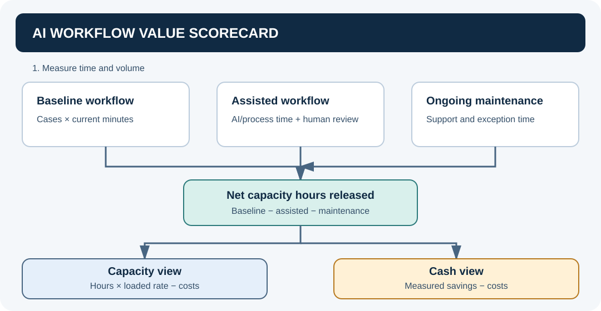

# AI Workflow Value Scorecard

A small, dependency-free Python calculator for comparing a fictional or approved workflow before and after an AI-assisted change.

## What it separates

- **Capacity released:** baseline handling time less assisted handling, human review and ongoing maintenance.
- **Theoretical capacity value:** capacity hours multiplied by the supplied loaded hourly rate. This is not a cash saving.
- **Net capacity value:** theoretical capacity value less recurring tool/other cash costs and monthly setup-cost amortisation.
- **Net cash impact:** measured monthly cash savings less those same costs. Measured savings default to zero; do not enter an estimate as a realised saving.

Negative capacity hours are retained. They mean the assisted process adds work after review and maintenance are counted.

## Flow



## Quick start

Requires Python 3.10+ and only the standard library.

```bash
python scorecard.py
python -m unittest discover -s tests -v
python scorecard.py --input sample_workflow.json --output report.json
```

## Input fields

| Field | Meaning |
|---|---|
| `monthly_volume` | Number of cases handled each month |
| `baseline_minutes_per_case` | Current end-to-end handling minutes per case |
| `assisted_minutes_per_case` | Staff time per case in the assisted workflow, excluding review |
| `human_review_minutes_per_case` | Additional human checking time per case |
| `monthly_maintenance_hours` | Ongoing monthly support and maintenance time |
| `loaded_hourly_rate_eur` | User-supplied hourly cost assumption for capacity valuation |
| `monthly_tool_cost_eur` | Recurring tool/licence cash cost |
| `monthly_other_cash_cost_eur` | Other recurring cash costs (optional; defaults to zero) |
| `one_time_setup_cost_eur` | One-off implementation/setup cost |
| `setup_amortisation_months` | Months over which setup cost is spread for comparison |
| `measured_monthly_cash_savings_eur` | Verified avoidable cash savings (optional; defaults to zero) |

The included JSON is entirely fictional and uses EUR for illustration. Replace values only with synthetic or specifically authorised data.

## Limitations and safe use

- Educational calculator, not financial, tax, legal or investment advice.
- It does not forecast revenue, job reductions, productivity gains, error rates or service quality.
- It does not assume released time becomes cash. A business must identify what happens to the capacity and separately verify any cash saving.
- The supplied hourly rate is an assumption, not an independently verified payroll figure.
- VAT, financing, tax treatment, risk costs and non-financial benefits are outside scope.
- Use a human reviewer and compare quality, exceptions and customer impact before adopting any workflow change.
- No live systems, personal data, customer records or employer information are accessed.
